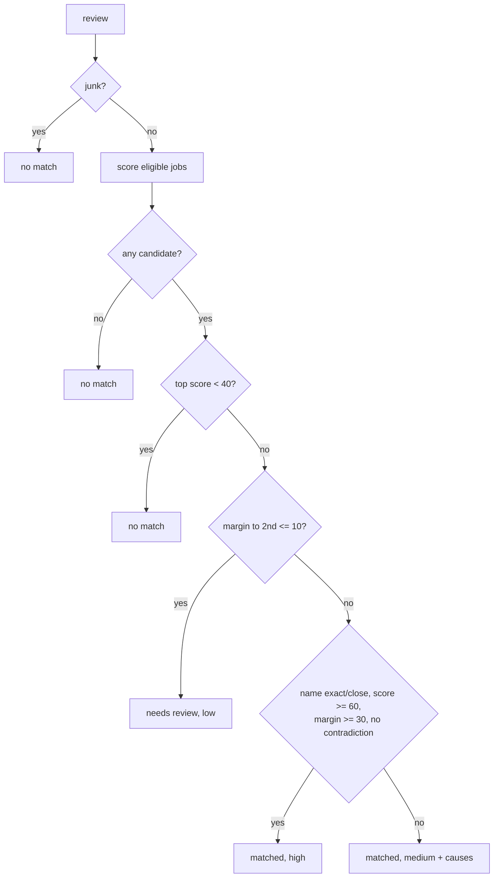

# Matcher workflow

How `decide()` in `python/matcher.py` turns one review into one outcome. The first rule that fires wins.

```text
decide(review, jobs)
  junk_reason()                  -> no match          test text, placeholder author,
                                                      future post, service not offered
  score_candidates()
    eligible_jobs()              drop jobs that started after the review was posted
    for each remaining job
      _identity()                no signal -> not a candidate
        name_match   exact 40 | close 30 | partial 15
        email key    30 (only if no name matched)
        relative     20 ("my husband Dave")
      _timing()
        link click   +40 / 30 / 20 / 10 (tiers: <=1h, <=6h, <=48h, <=168h before the review)
                      0 if the click came after the review
        request      +10 (<=72h before, no click) | -20 (sent after the review)
        recent       +5  (job started within 30 days)
      service        +20 text matches the job type | -30 mismatch
      crew           +10 crew member named in the text
  rank by score
  no candidates                  -> no match
  top < 40                       -> no match
  top - second <= 10             -> needs review (low)
  else matched
       high   = exact/close name, score >= 60, margin >= 30,
                no negative signal, no stronger-identity runner-up
       medium = matched, but at least one of those fails; each failure is listed as a cause
```



## Notes

- Timing can beat an exact name match: a name-only hit is worth 40, and a click within the hour is worth 40 on its own.
- The weights and thresholds are tuned on the 40-review sample without labels, so they may be overfit (see the `ponytail:` comments in `matcher.py`).
